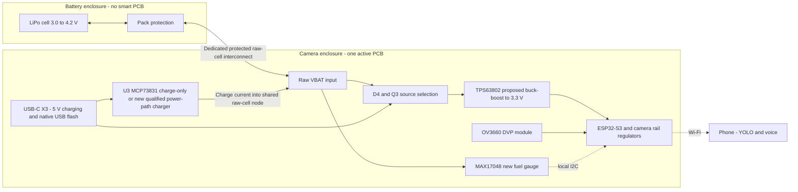
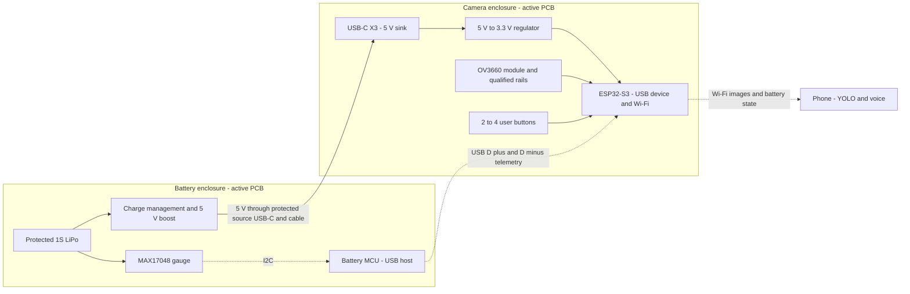
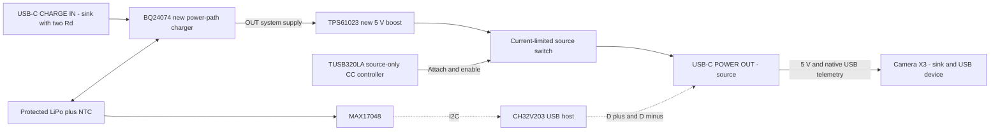
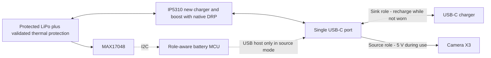
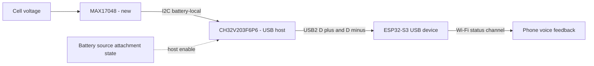

# Two enclosures, two electronic architectures

## 1. Architecture 1 — one active PCB; protected passive battery pack

All camera, Wi-Fi, charging, regulation and fuel-gauge electronics stay on the camera PCB. The other enclosure contains only the cell and its permitted pack-protection circuit. There is **no smart-battery PCB and no battery-side 5 V boost**.



ASCII fallback:

```text
BATTERY ENCLOSURE                 CAMERA ENCLOSURE: ALL ACTIVE ELECTRONICS
[cell + pack protection] <----raw VBAT/GND----> [battery node + fuel gauge]
                                                   ^           | I2C
[X3 USB-C: charger/PC 5V] --> [charger] -------------+           v
               |                  battery/USB selector --> [buck-boost 3.3V]
               +------------------------^                         |
                                                   [OV3660 + ESP32-S3]
                                                              ~ Wi-Fi ~ phone
```

**Connector constraint that must be decided:** raw cell voltage is 3.0–4.2 V, not USB VBUS 5 V. A passive battery enclosure cannot be a normal USB-C 5 V source. Do not wire raw LiPo to an ordinary source USB-C VBUS connector and describe it as standard USB power. X3 remains a 5 V sink/development port; the raw-cell connection needs a separate keyed, protected interconnect. If the product must retain a detachable standard USB-C-to-USB-C power cable, choose architecture 2. A proprietary Type-C-shaped raw-cell interface would need independent misuse/short/reversal qualification and is **not recommended or approved here**. This conflict cannot be removed just by changing CC resistors.

Existing U3, R4, CHG, R2, Q3, D4, R12, X1 and C3 have functions in this architecture and are not removed merely because there are two enclosures. MCP73831 is charge-only, has no true system power-path and no cell-temperature input; charging with an active system load can interfere with termination. If simultaneous operation and charging is required, select a proper charger/power-path solution such as the new BQ24074 and redesign the selector. A gauge at the camera end senses cable drop; cable/connector resistance and SOC calibration need review. Keep the cell's independent protection and temperature limits.

The old U2 LDO cannot hold 3.3 V as the cell falls below dropout. The proposed TPS63802 C2845237 is appropriate here because its input crosses 3.3 V. The documented 46-placement baseline is a starting point, not a manufacturing-ready version with the replacement gauge/camera qualified.

## 2. Architecture 2 — camera PCB and smart-battery PCB



ASCII fallback:

```text
BATTERY PCB                         USB-C USB2 CABLE        CAMERA PCB
protected cell -> boost/source ---- 5V + GND -------------> X3 -> buck 3.3V
      |                                                        |
      +-> MAX17048 --I2C--> MCU host --D+/D- native USB----> ESP32-S3 device
                                                              | DVP
                                                            OV3660
                                                         Wi-Fi -> phone
```

The regulated 5 V bus moves charging/gauge functions off the camera board. Q3/D4's old VBUS/VBAT selection becomes redundant **only after** the board is redesigned for the single 5 V input. This is a documented net delta, not an instruction to remove parts from an otherwise unchanged board.

### 2a. Two battery USB-C ports — product owner's current preference



ASCII fallback:

```text
CHARGE IN (sink, Rd) -> BQ24074 power-path -> OUT -> TPS61023 boost
                              ^                       |
                        cell + PCM + NTC        source switch -> POWER OUT -> camera
                              |                    ^
                         MAX17048 -> MCU       source CC controller
                                      \--- USB data ---------> camera ESP32
```

Charge input and power output are physically separate and should be labelled in text/raised symbols. The charge-input port's D+/D− are not connected to the host telemetry bus. Two ports do not alone create safe charge-through: input-current limits, dynamic power-path behaviour, reverse-current isolation, cell/charger temperature and net charging at the running load must be validated. A 500 mA input may power the load but fail to charge, or even discharge the cell. Enable the source switch only after sink attachment. Validate reverse blocking for wrong-port connections; add it if the selected switch cannot provide the required isolation in all states.

Indicative new blocks: BQ24074 C54313, TPS61023 C919459, TUSB320LA C132554, TPS2553 C55266, MAX17048 C2682616, CH32V203 C3040880. This deliberately uses **new** charge/power-path circuitry rather than pretending U3 already has these features. A lower-cost prototype can relocate the existing MCP73831 C424093, but then forbid/usefully constrain charge-while-operating and add missing thermal/USB protection features. Two ports cost an extra opening and connector, but make roles explicit and avoid a one-port DRP integration dependency.

### 2b. One battery USB-C port — conditional IP5310 DRP alternative



ASCII fallback:

```text
cell + protection <-> IP5310 charge/boost/DRP <-> ONE USB-C PORT
                                                    +-- charger: battery is sink
                                                    +-- camera: battery is source
cell -> MAX17048 -> role-aware MCU -> USB data only in source/host mode
```

No simultaneous camera cable and charger on a single port. Qualify **IP5310 C191176 exact supplied variant**, not a generic family claim: charge-current configuration suitable for a small cell, cell CV tolerance, source-current advertisement, source/sink transitions, external VBUS MOSFET circuit, low-load cutoff and MCU role/USB-line isolation. Standard version defaults and custom I2C variants are not interchangeable. The available I2C-specific C20616661 was separately checked; stock status is in the catalogue. Default 3 A advertisement and approximately 3 A charging must not be accepted for a thin 1C cell. The reviewed IP5310 CV table reaches 4.24 V typical/4.27 V maximum: reconcile with the selected cell's permitted voltage before selection. This is a **qualification gate**, not a validated substitute.

The reviewed IP5310 no-load cutoff is approximately 45 mA typical (20–80 mA range), after roughly 32 s typical (25–44 s). Normal camera operation is above that, but sleep, startup and low-power modes must be tested. The reference design uses a 1 µH inductor and external VBUS switching; neither is omitted just because the power MOSFETs are integrated.

IP5306 and IP2312 do **not** independently solve this DRP problem: the former has no CC1/CC2 role controller, the latter is a charger without the necessary discharge boost. IP5328P is not a drop-in guarantee of USB-C DRP either.

## 3. Battery telemetry



ASCII fallback:

```text
cell -> MAX17048 --I2C--> battery MCU USB host --USB2--> ESP32 USB device
                                                           |
                                                      Wi-Fi -> phone -> voice
```

**Recommended:** new MAX17048 C2682616 plus CH32V203F6P6 C3040880 on the battery PCB. Power source/USB data host roles are aligned, so no USB-PD data-role swap is needed for this dedicated accessory. ESP32 native D− is GPIO19, D+ GPIO20. Unplug the battery and connect a PC to X3 for normal flashing; do not put raw UART on those pins at the same time. Firmware feasibility, enumeration and reconnection still require implementation/testing. MCU is Extended, not Basic.

A minimal application message, carried over a USB bulk/CDC-style transport chosen during firmware integration:

```text
A5 5A | VER=01 | LEN=08 | SEQ_LE16 | SOC8 | FLAGS8 | VBAT_mV_LE16 |
TEMP_s8 | RESERVED8 | CRC_LE16
```

14 bytes total; CRC-16/CCITT-FALSE, polynomial 0x1021, initial 0xFFFF, non-reflected, xor-out 0, over VER through RESERVED. Battery initiates once/s and immediately on faults. SOC=255 and TEMP=0x7F mean unknown; temperature requires an actual sensor (MAX17048 does not provide a substitute for a measured cell NTC). Proposed flags: bit0 charging, bit1 source enabled, bit2 low battery, bit3 fault, bit4 cell-temperature valid; remaining bits zero. Sequence detects duplicates; CRC/framing support the proprietary UART fallback too. After 3 s without valid updates, phone reports battery state unknown instead of repeating an old percentage. Proposed low thresholds 20%/10%, with hysteresis and non-repeating voice feedback to be agreed with Amine.

**Prototype fallback:** CH32V003 C5187096, UART 115200 8N1 over the USB cable D+/D−, battery TX→D+→camera RX GPIO2; camera TX GPIO1→D−→battery RX. This is not standard USB signalling. X3 already wires D+/D− to GPIO20/19, so use a qualified mux/isolation network such as TS3USB221A C128396, safe default PC-flash mode, role detection and high-impedance battery outputs when charging. Never short USB outputs to UART outputs. Direct wiring is not an industrial-ready design. GPIO1 also conflicts with the proposed optional VBUS ADC detector; allocate it once, not twice.

**No-telemetry V1:** local charge/low LEDs are possible, but a regulated 5 V bus does not reveal SOC to the camera. Power loss can be abrupt. A VBUS detector can detect collapse, not guarantee advance voice warning: 100 µF at 0.5 A with 0.5 V headroom lasts only 0.1 ms; 100 ms would require about 0.1 F. Do not claim ordinary decoupling provides spoken warning. SBU1/SBU2 are not guaranteed in ordinary USB2 cables; leave unused in the baseline.

## 4. USB-C cable and roles, architecture 2

Use a **USB2 data-capable C-to-C cable**, not a power-only cable. Port pins are receptacle names; the CC path depends on plug orientation and is not two permanently straight-connected CC wires.

| Signal / receptacle pins | Battery power-output port | Camera X3 | Implementation |
|---|---|---|---|
| VBUS A4/A9/B4/B9 | Switched regulated 5 V source | 5 V sink | Design ceiling 1.5 A output; cell-side current is higher. Current limit, inrush and DC overvoltage protection need closure. |
| GND A1/A12/B1/B12 | Common return | Common return | Include shield/ESD strategy in layout. |
| D+ A6/B6 | USB-host D+ | ESP32 GPIO20 | Pair duplicate receptacle USB2 pins locally. Native USB recommended. |
| D− A7/B7 | USB-host D− | ESP32 GPIO19 | Controlled routing, ESD, no simultaneous UART drive. |
| CC1 A5 / CC2 B5 | Source controller Rp | Separate Rd 5.1 kΩ each | Existing R8=CC1 and R5=CC2. Never one shared Rd. |
| SBU1 A8 / SBU2 B8 | Not connected | Not connected | Not relied on in USB2 cable. |
| SuperSpeed pairs | Not used | Not used | Not present in a basic USB2 passive cable. |

For resistor-based CC referenced to 5 V: Rp 56 kΩ advertises default USB current, 22 kΩ advertises 1.5 A, 10 kΩ advertises 3 A. A controller may generate equivalent current sources; do **not** add these resistors in parallel with its internal Rp. Prefer a qualified 1.5 A advertisement only if the complete cell/boost/switch/cable can sustain it; otherwise advertise less. Default USB current still requires observing the applicable USB rules; it is not permission to draw arbitrary current. Two-port charge input has its own two Rd resistors and input-current budget based on the attached source.

AWG24 is approximately 0.0842 Ω/m per conductor, AWG26 0.1339 and AWG28 0.2129. Loop resistance is 2 × length × conductor resistance (before parallel conductors/contacts):

| Cable length/gauge | Drop at 1.2 A, power loop only |
|---|---:|
| 0.5 m, AWG24 | 0.101 V |
| 1.0 m, AWG24 | 0.202 V |
| 1.0 m, AWG26 | 0.321 V |
| 1.0 m, AWG28 | 0.511 V |

Allow another example 0.1 Ω for switches/contacts (0.12 V at 1.2 A). Prefer 0.2–0.5 m behind the head; ≤1 m only with verified conductor gauge and input margin. TPS562201 needs at least 4.5 V: 4.75 V source-low minus cable/contact loss may already violate that. Lower-minimum-input SY8089A1AAC is an alternative requiring its own qualification. Measure at X3 under peak camera/radio load.

## 5. Electrical and energy budgets

A boost is sufficient because the protected 1S cell always stays below the desired 5 V. At 3.0 V and 90% boost efficiency, delivering 5 V × 1.5 A needs **2.78 A from the cell**, before extra loss. Qualify a ≥3 A cell/PCM/path if advertising a full 1.5 A throughout discharge. A ≥2 A cell requirement alone is not enough for that maximum. The source ceiling is not the expected average load.

Day estimate 0.4–0.6 A at 3.3 V; optional IR adds approximately 0.1–0.3 A unless already included in a measured budget. Prior worst-case 0.91 A at 3.3 V is a design allocation, not a measurement. At 0.91 A, 90% buck efficiency gives about 0.67 A from 5 V before other battery-side loads; design for peaks, inrush and enclosure temperature, not only average watts.

For 1500 mAh, 3.7 V nominal, 90% usable energy, 90% boost and 90% buck efficiency, plus 0.07 W accessory overhead, indicative runtimes are: 0.4 A rail → 2.91 h; 0.5 A → 2.35 h; 0.6 A → 1.97 h; 0.7 A → 1.70 h; 0.91 A → 1.32 h. Three hours needs about 2.28 Ah at 0.6 A, 2.65 Ah at 0.7 A or 3.42 Ah at 0.91 A. Architecture 1 avoids one conversion stage but still needs measured energy and cable-loss validation.

## 6. Thin-cell candidates — dimensional leads, not qualified selections

| Offer / supplier | Capacity; full dimensions; mass | Observed price / availability on 23 Nov | Documented limit and verdict |
|---|---|---|---|
| [AKYGA AKY0105 LP584070 / TME](https://www.tme.eu/en/details/aky-lp584070/rechargeable-batteries/akyga-battery/aky0105/) | 1500 mAh; pack max 72.5 × 41 × 6.3 mm; about 28 g datasheet (29.9 g catalogue) | USD 7.99 net; 153 | 1C = 1.5 A continuous; PCM; approximately 3.0 V cutoff. Thin, but not ≥2 A. |
| [AKYGA AKY0638 LP603450 / TME](https://www.tme.eu/en/details/aky-lp603450/rechargeable-batteries/akyga-battery/aky0638/) | 1200 mAh; pack max 52.5 × 35 × 6.5 mm; about 22 g | USD 6.90 net; 996 | 1C = 1.2 A continuous; PCM. More compact, not ≥2 A. |
| [Adafruit 258 / PKCELL 503562](https://www.adafruit.com/product/258) | 1200 mAh; advertised 34 × 62 × 5 mm; 23 g | USD 9.95; in-stock flag | Cell 1C = 1.2 A; protection included; seller says charge ≤500 mA. Cable's 2 A rating is not the cell discharge rating. |

Vendor observations are from the source review; not a live reservation or proof of shipping eligibility. Cell datasheets, not marketplace cable ratings, set the limit. LCSC/JLCPCB assembly is not a qualified supply route for these packs. Obtain ≥2 A continuous (preferably ≥3 A for full source rating) documentation from the cell manufacturer, PCM current/voltage/temperature limits and a production drawing before purchase. Charge around 0.5C or lower only within the selected cell's limits. Proposed BQ24074 2 kΩ ISET gives approximately 445 mA typical, below 500 mA including the reviewed tolerance; predicted charge times roughly 3.2–3.7 h for 1200 mAh and 3.9–4.4 h for 1500 mAh (CC/CV, no running load).

Cell mass alone is 22–30 g against the repository's 40–50 g total wearable target; include both PCBs, cable, connectors, optics and printed enclosures before promising the target. Pack thickness includes PCM and tabs, not just bare pouch thickness. Preserve swelling clearance and strain relief.

## 7. Protection and qualification boundaries

Independent pack over/undervoltage, overcurrent and thermal limits are required. A generic DW01-style 2.4–2.5 V cutoff is not automatically acceptable for a cell specified to stop at 3.0 V. New BQ24074's standard NTC temperature window is not automatically the cell's 0–45 °C charging window; qualify the network/controller against the cell. MCP73831 has no NTC input. Reverse battery/port faults, source backfeed, source VBUS discharge, inrush, short circuit and hot-plug need explicit schematics and tests.

USBLC6-2SC6 C7519 is an ESD network candidate, not DC overvoltage protection. PESD5V0S1UL C85402 has a 5 V working-voltage class: confirm suitability at maximum USB VBUS, leakage/clamping and the protected IC limits; replace if unsuitable. Do not regard these budget entries as a closed protection design. The low-profile 150 µF output capacitor adds inrush and discharge timing constraints. Source CC/USB safety is not provided by a boost alone.
