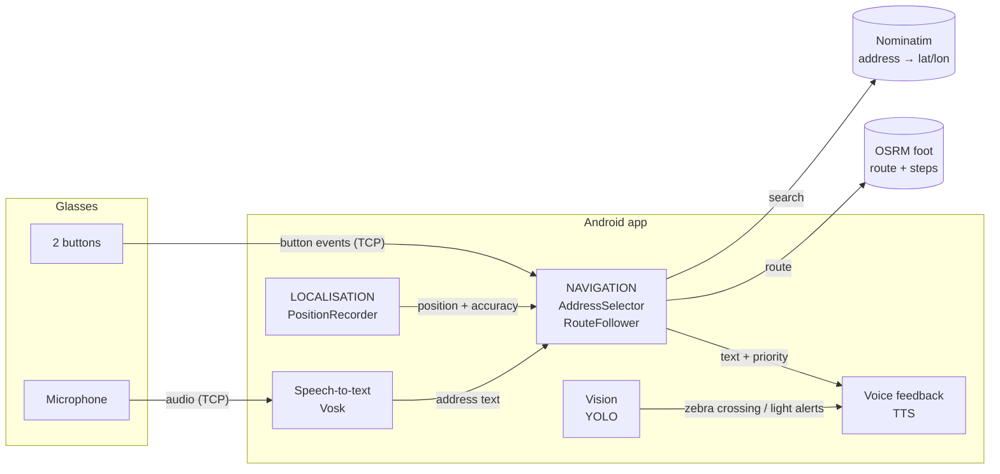

# Navigation brick — architecture and interfaces

Brick 4 of CyclopeGEN 3: "dictated address, route, voice guidance, and contribution of missing
crossings to OpenStreetMap". Tools from the project slides: Vosk · Nominatim · OSRM · TalkBack.
Rule: open source only, no Google Maps.

## 1. Block diagram



Bold blocks (NAVIGATION, LOCALISATION) are this brick. The others are stubbed in the test app
so this brick does not wait for anybody.

## 2. User flow

1. **Long press** on the glasses → listening starts (beep) → user dictates the address → STT gives text.
2. `NominatimClient.search(text, near = user position)` → candidates, **sorted by distance** to the user
   (54 rue Jean Jaurès exists in many towns).
3. `AddressSelector` reads the candidates aloud. **Short** = next, **Long** = choose, **Double** = none is correct (dictate again).
4. `OsrmClient.route(user, destination)` → walking route with steps.
5. `RouteFollower` receives every position fix and decides what to say:
   - departure: "Dirigez-vous vers le nord sur Rue A. Puis continuez sur 100 mètres."
   - at 50 m: "Dans 50 mètres, tournez à droite sur Rue B."
   - at 12 m: "Maintenant, tournez à droite sur Rue B."
   - arrival, off-route (3 bad fixes in a row → re-route), weak GPS (accuracy > 35 m → fix ignored).
6. Each message goes to the voice module with a priority (INFO / INSTRUCTION / WARNING).

## 3. What the APIs already give vs. what we add

(Question from the kick-off: "look at what the APIs already provide and what must be added on top".)

| Need | Already provided | Added by us (code) |
|---|---|---|
| Address → coordinates | Nominatim: candidates with coordinates, full address | Short speakable name, sort by distance, bias around the user (`viewbox`), France filter, 1 req/s limit + User-Agent (usage policy) — `Nominatim.kt` |
| Choose between homonym addresses | — | Button-driven choice incl. "none is correct" — `AddressSelector.kt` |
| Walking route | OSRM `foot` profile: geometry, steps with type/modifier/street/distance | Client + parser — `Osrm.kt` |
| Spoken instructions | OSRM gives data, not French sentences (its text library `osrm-text-instructions` is JavaScript) | French/English sentences, pedestrian distance rounding, cardinal direction at start — `InstructionFormatter.kt` |
| Following the user in real time | **Nothing** (OSRM computes once) | Snap fix to route, 50 m / 12 m announcements, arrival, off-route detection + re-route, weak-GPS gate — `RouteFollower.kt` |
| Position | Android: 3 providers + sensors | Comparison study + own PDR fusion — `PositionRecorder.kt`, `PdrFusion.kt` |
| Zebra crossings on the route | OSM has crossing nodes (`highway=crossing`, `crossing=zebra / traffic_signals`) | **Next**: query them along the route (Overpass API) to announce crossings; later, report missing ones to OSM |

Servers used for the prototype (both community-run, free, max 1 request/s, identifying User-Agent required):
`nominatim.openstreetmap.org` and `routing.openstreetmap.de/routed-foot` (FOSSGIS OSRM with a real
pedestrian profile — the `router.project-osrm.org` demo is car-only). For the final product both can be
self-hosted (Docker) if needed.

## 4. Interfaces (to freeze with the team)

Defined in `navigation/src/main/java/.../NavigationInterfaces.kt`.

| Direction | Interface | Partner block | Stub in the test app |
|---|---|---|---|
| out | `VoiceOutput.speak(text, priority)` | Voice feedback (Shana) | Android `TextToSpeech` |
| in | `AddressInputListener.onAddressDictated(text)` | Speech-to-text / microphone | text field |
| in | `ButtonListener.onButton(SHORT_PRESS / LONG_PRESS / DOUBLE_PRESS)` | Firmware buttons over TCP | 3 on-screen buttons |
| in | `PositionListener.onPosition(source, point, accuracy, time)` | (this brick) | — |

Priority proposal for the voice module: vision safety alerts (zebra crossing, red light) > navigation
WARNING > navigation INSTRUCTION > INFO.

## 5. Code map

```
navigation/                     Gradle module = the brick
  core/  (pure Kotlin, unit-tested on PC: ./gradlew :navigation:test)
    Geo.kt                  distances, bearings, projection on a segment
    Route.kt                Route / RouteStep / RouteGeometry (snapping)
    Http.kt                 HTTP GET + 1 req/s rate limiter
    Nominatim.kt            geocoding client + parser
    Osrm.kt                 routing client + parser
    InstructionFormatter.kt French / English sentences
    AddressSelector.kt      button-driven choice of the address
    RouteFollower.kt        path tracking + announcements
    PdrFusion.kt            source 5: GNSS + steps + compass
    RouteSimulator.kt       fake walk for indoor demos
  positioning/PositionRecorder.kt   records the 5 sources (Android)
  NavigationInterfaces.kt           contracts with the other blocks
app/                            test harness (not the final UI)
tools/analyze_positions.py      CSV → metrics table + plot
```

## 6. Open questions

1. Button mapping (short / long / double) — to agree with the firmware teammate.
2. Voice language: French only, or French + English?
3. OK to use the public FOSSGIS / Nominatim servers for the prototype, or self-host from the start?
4. TalkBack: the final app must stay usable with TalkBack on — to test once the UI exists.
5. Phone carried in pocket vs hand: affects the compass heading used by PDR.
